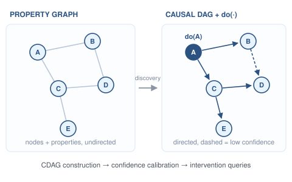
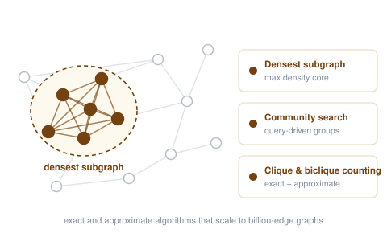
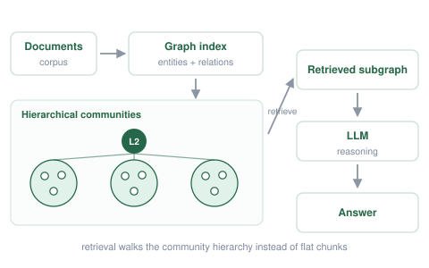

<h1 id="-research-overview">🔭 Research Overview</h1>

  
My research agenda is <strong>reliable and scalable knowledge-enhanced LLM systems</strong>. Knowledge passes through three stages before a model can use it — it is <strong>acquired</strong>, <strong>retrieved</strong>, and then <strong>augments</strong> generation and reasoning. <em>Reliable</em> here means explainable: the system should be able to account for what it used and why. <em>Scalable</em> means those properties still hold at real data sizes.

  
Q1 Knowledge Acquisition. Counterfactual data construction, and the learned data systems that make the underlying data fast and trustworthy to serve.

  
Q2 Knowledge Retrieval. RAG indexing and tuning, built on scalable graph primitives: densest subgraph discovery, community search, clique and biclique counting, graph similarity.

  
Q3 Knowledge Augmentation. Graph-based RAG, structured memory, and agentic retrieval for knowledge-intensive tasks.

<h1 id="-research-topics">🧩 Research Topics</h1>

  

    
  

  

    Q1
    <h3 style="color:#2c5282;">Knowledge Acquisition</h3>
    
Before a model can use knowledge, something has to construct it. I work on counterfactual construction, so that what a system later retrieves can be traced back to an intervention rather than a correlation, and on the data systems that have to serve it at speed.

    <ul class="rt-lines">
      <li><b>Counterfactual data construction</b> ERC Go-Y, ongoing</li>
      <li><b>Pretrained models for database optimization</b> VLDB'25VLDBJ'26</li>
      <li><b>LLM-based test-case generation for DBMS</b> ICSE'26 · Best Paper</li>
      <li><b>Real-time data warehouse engines</b> VLDB'25 with Alibaba Cloud</li>
    </ul>
  

  

    
  

  

    Q2
    <h3 style="color:#276749;">Knowledge Retrieval</h3>
    
Retrieval is only as good as the index underneath it, and on graph data that index is a dense-structure problem. The algorithms below are what let graph-based retrieval stay tractable on billion-edge graphs.

    <ul class="rt-lines">
      <li><b>RAG indexing and tuning</b> SIGMOD'26ICDE'26VLDB-W'25</li>
      <li><b>Densest subgraph discovery</b> SIGMOD'24VLDB'25 ×2SIGMOD'26 ×2KDD'26</li>
      <li><b>Community search</b> VLDB'23SIGIR'25VLDB'26SIGMOD'26</li>
      <li><b>Counting and similarity</b> VLDB'24 ×2VLDB'25VLDB'26 ×2</li>
    </ul>
  

  

    
  

  

    Q3
    <h3 style="color:#744210;">Knowledge Augmentation</h3>
    
Once the knowledge is retrieved, how should it reach the model? I study graph-based RAG, structured memory, and the point where retrieval stops being a pipeline stage and becomes something the agent plans for itself.

    <ul class="rt-lines">
      <li><b>Unified analysis of graph-based RAG</b> VLDB'25 DIGIMON</li>
      <li><b>Hierarchical community retrieval</b> AAAI'26 ArchRAG</li>
      <li><b>Evolving and long documents</b> arXiv EraRAG, BookRAG</li>
      <li><b>Memory and agentic retrieval</b> VLDB-W'25Under Review</li>
    </ul>
  

<h1 id="-open-source-projects">💻 Open-source Projects</h1>

<ul class="os">
  <li>
    🔮 <strong><a href="https://github.com/JayLZhou/GraphRAG">DIGIMON / GraphRAG</a></strong> — the first unified graph-based RAG prototype system for structured retrieval and reasoning over complex data.
    
  </li>
  <li>
    ⏳ <strong><a href="https://github.com/EverM0re/EraRAG-Official">EraRAG</a></strong> — the first graph-based RAG system to handle evolving documents.
    
  </li>
  <li>
    📚 <strong><a href="https://github.com/sam234990/BookRAG">BookRAG</a></strong> — a hierarchical structure-aware index for retrieval-augmented generation over complex documents.
    
  </li>
  <li>
    🌍 <strong><a href="https://github.com/D2I-CUHKSZ/MicroWorld">MicroWorld</a></strong> — turns multi-modal event material into structured graphs, agent populations, and inspectable social simulations.
    
  </li>
</ul>
